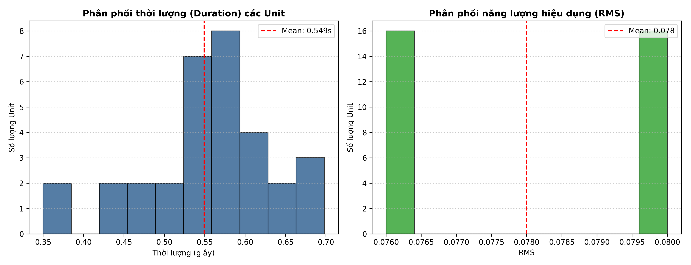
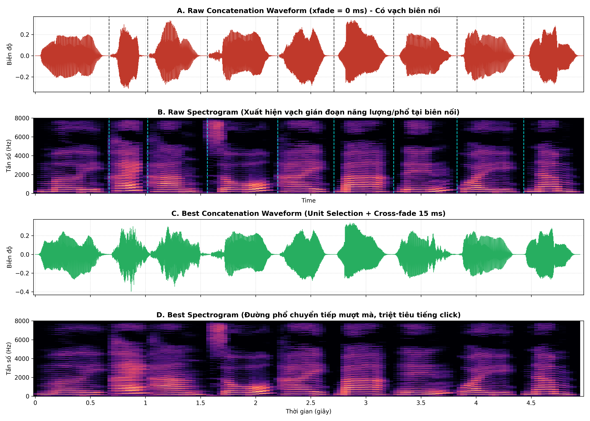
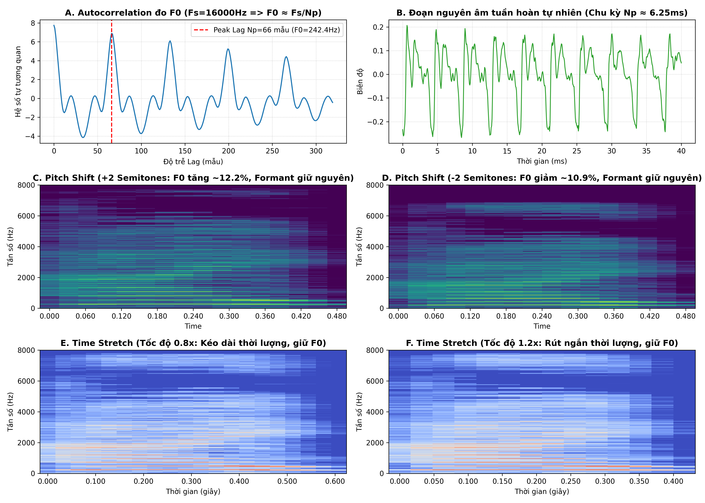
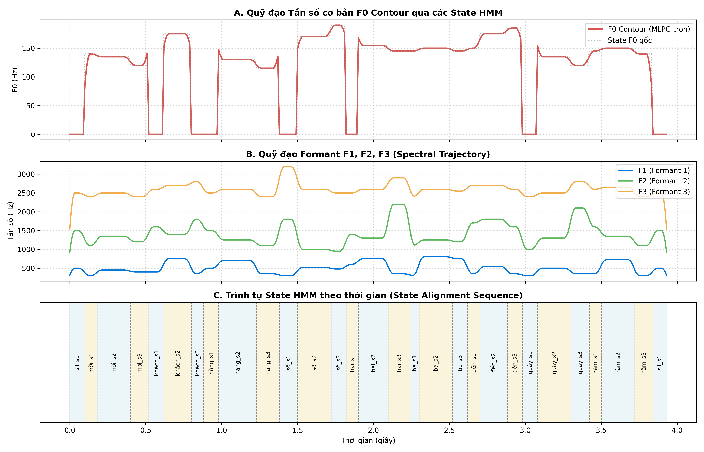
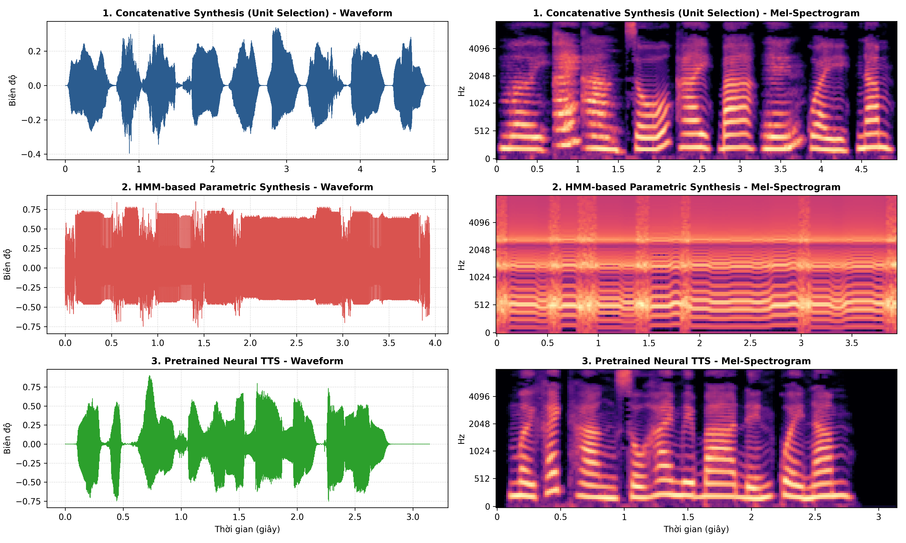

# BÁO CÁO KẾT QUẢ THỰC HÀNH LAB 4
## HỌC PHẦN: XỬ LÝ ÂM THANH VÀ TIẾNG NÓI (CSE457)
### CHỦ ĐỀ: TỔNG HỢP TIẾNG NÓI (TEXT-TO-SPEECH - TTS)
**Từ kiến trúc TTS, ghép nối và Unit Selection đến tổng hợp tham số HMM và TTS học sâu**

---

* **Sinh viên thực hiện:** Nguyễn Thị Linh
* **Mã số sinh viên:** 2351260663
* **Lớp:** Trí tuệ Nhân tạo - Khóa 65
* **Khoa:** Công nghệ Thông tin - Trường Đại học Thủy Lợi
* **Thời gian thực hiện:** Học kỳ I - Năm học 2026-2027

---

## MỤC LỤC
1. [Mục tiêu và Tổng quan Bài thực hành](#1-mục-tiêu-và-tổng-quan-bài-thực-hành)
2. [Cơ sở Lý thuyết và Công thức Toán học](#2-cơ-sở-lý-thuyết-và-công-thức-toán-học)
3. [Thiết kế Hệ thống và Chuẩn bị Dữ liệu (Phần A)](#3-thiết-kế-hệ-thống-và-chuẩn-bị-dữ-liệu-phần-a)
4. [Thực nghiệm Ghép nối Cơ sở - Baseline Concatenation (Phần B)](#4-thực-nghiệm-ghép-nối-cơ-sở---baseline-concatenation-phần-b)
5. [Tối ưu hóa Chọn đơn vị và Làm mượt biên - Unit Selection & Smoothing (Phần C)](#5-tối-ưu-hóa-chọn-đơn-vị-và-làm-mượt-biên---unit-selection--smoothing-phần-c)
6. [Phân tích Ngữ điệu và Mô hình Nguồn - Lọc (Phần D)](#6-phân-tích-ngữ-điệu-và-mô-hình-nguồn---lọc-phần-d)
7. [Tổng hợp Tham số thống kê HMM-based Synthesis (Phần E)](#7-tổng-hợp-tham-số-thống-kê-hmm-based-synthesis-phần-e)
8. [Tổng hợp Tiếng nói Học sâu - Neural TTS Pretrained (Phần F)](#8-tổng-hợp-tiếng-nói-học-sâu---neural-tts-pretrained-phần-f)
9. [Đánh giá Thực nghiệm, Thẩm định Nghe và So sánh Đối chiếu (Phần G)](#9-đánh-giá-thực-nghiệm-thẩm-định-nghe-và-so-sánh-đối-chiếu-phần-g)
10. [Phân tích 5 Thí nghiệm Bắt buộc](#10-phân-tích-5-thí-nghiệm-bắt-buộc)
11. [Trả lời Chi tiết 10 Câu hỏi Báo cáo](#11-trả-lời-chi-tiết-10-câu-hỏi-báo-cáo)
12. [Kết luận và Bài học Kinh nghiệm](#12-kết-luận-và-bài-học-kinh-nghiệm)

---

## 1. Mục tiêu và Tổng quan Bài thực hành

### 1.1. Mục tiêu đào tạo
Bài thực hành Lab 4 giúp sinh viên kết nối các kiến thức nền tảng về xử lý tín hiệu số, đặc trưng phổ - âm học và các mô hình xác suất thống kê để giải quyết bài toán phát sinh dạng sóng âm thanh từ văn bản (*Text-to-Speech Synthesis - TTS*).

Cụ thể, bài thực hành hướng đến các chuẩn đầu ra:
1. **Nắm vững kiến trúc tổng quát của hệ thống TTS**: hiểu rõ luồng chuyển dịch dữ liệu qua các khối chức năng: Phân tích và chuẩn hóa văn bản (*Text Analysis & Normalization*) $\rightarrow$ Phân tích ngữ âm/phiên âm (*Phonetic Analysis/G2P*) $\rightarrow$ Mô hình ngữ điệu (*Prosody Generation*) $\rightarrow$ Bộ tổng hợp âm học (*Synthesis Backend*) $\rightarrow$ Tái tạo dạng sóng (*Waveform Generation/Vocoder*).
2. **Xây dựng hệ thống ghép nối (Concatenative Synthesis)**: Xây dựng kho ngữ âm (*Inventory*), chuẩn hóa mức năng lượng (RMS), tần số lấy mẫu ($F_s$), thực thi thuật toán chọn đơn vị âm thanh tối ưu (*Unit Selection*) qua Quy hoạch động (*Dynamic Programming/Viterbi*) kết hợp kỹ thuật làm mượt biên (*Cross-fade/OLA*).
3. **Hiểu và vận dụng mô hình Nguồn - Lọc (Source - Filter Model)**: Phân tích vai trò của tần số cơ bản ($F_0$), chu kỳ pitch ($N_p$), formant ($F_1, F_2, F_3$) và thực nghiệm biến đổi ngữ điệu (thay đổi tốc độ qua time-stretch, thay đổi cao độ qua pitch-shift).
4. **Hiểu cơ chế tổng hợp tham số HMM (HMM-based Speech Synthesis)**: Nắm vững cách HMM chạy ở chế độ phát sinh (*Generation mode*), cơ chế làm trơn quỹ đạo tham số âm học nhờ đặc trưng động học delta (*MLPG algorithm*), và tái tạo âm thanh qua bộ lọc thanh đạo.
5. **Thực thi và đánh giá hệ thống TTS học sâu (Neural TTS)**: Chạy suy luận với mô hình học sâu pretrained offline, trích xuất mel-spectrogram và đo đạc độ trễ suy luận (*inference latency*).
6. **Đánh giá thẩm định chất lượng toàn diện**: Tiến hành bài kiểm tra nghe chủ quan (*MOS - Mean Opinion Score test*), đánh giá 3 hướng tiếp cận theo 5 tiêu chí: Độ rõ âm (*Intelligibility*), Tính tự nhiên (*Naturalness*), Độ liền mạch (*Continuity*), Độ trễ (*Latency*) và Yêu cầu tài nguyên bộ nhớ.

### 1.2. Kịch bản thực hành (Case Study)
Case study được áp dụng là hệ thống mini-TTS miền hẹp phục vụ cho **"Hệ thống Thông báo Xếp hàng Tự động"**:
* Câu văn bản kiểm thử chính: `"Mời khách hàng số 23 đến quầy 5."`
* Các câu kiểm thử mở rộng: `"Mời khách hàng số 104 đến quầy 2."`, `"Mời khách hàng số 89 đến quầy 3."`

---

## 2. Cơ sở Lý thuyết và Công thức Toán học

```
  +--------------+     +--------------+     +--------------+     +--------------+     +--------------+     +--------------+
  |   Văn bản    | --> |  Chuẩn hóa   | --> |   Phiên âm   | --> |   Ngữ điệu   | --> |  Bộ tổng hợp | --> |   Waveform   |
  |  (Input Text)|     | (Normalize)  |     | (G2P/Tokens) |     | (F0,Duration)|     |  (Backend)   |     |    (Audio)   |
  +--------------+     +--------------+     +--------------+     +--------------+     +--------------+     +--------------+
```

### 2.1. Chuẩn hóa văn bản và ánh xạ từ
Trong miền hẹp, quá trình chuẩn hóa chuyển đổi chuỗi ký tự thô $T$ thành chuỗi từ chuẩn hóa $W = (w_1, w_2, \dots, w_K)$:
$$T \xrightarrow{\text{normalize}} W = (w_1, w_2, \dots, w_K)$$
Đặc biệt, các chuỗi số (digits) được đọc tách rời thành từng chữ số theo ngữ cảnh số thứ tự: `"23"` $\rightarrow$ `["hai", "ba"]`. Vì sử dụng đơn vị từ ghép (*word-unit inventory*), hệ thống có thể bỏ qua bước phân tích G2P (Grapheme-to-Phoneme) đầy đủ ở mức âm vị.

### 2.2. Tần số cơ bản $F_0$ và chu kỳ Pitch $N_p$
Đối với tín hiệu tuần hoàn (âm hữu thanh - voiced speech), tần số cơ bản $F_0$ liên hệ nghịch đảo với chu kỳ pitch $N_p$ (tính theo số mẫu) ở tần số lấy mẫu $F_s$:
$$F_0 = \frac{F_s}{N_p} \iff N_p = \frac{F_s}{F_0}$$
*Ví dụ:* Tại $F_s = 16000\text{ Hz}$, nếu $N_p = 100$ mẫu thì $F_0 = 160\text{ Hz}$. Việc giảm $N_p$ sẽ làm tăng $F_0$ (giọng nghe cao hơn) và ngược lại.

### 2.3. Mô hình Nguồn - Lọc (Source - Filter Model)
Theo mô hình âm học Rabiner - Schafer, tiếng nói được biểu diễn dưới dạng tích chập giữa tín hiệu kích thích nguồn $e[n]$ và đáp ứng xung của thanh đạo $h[n]$:
$$X(z) = E(z) \cdot H(z) = E(z) \cdot \frac{B(z)}{A(z)} = E(z) \cdot \frac{b_0 + \sum_{k=1}^M b_k z^{-k}}{1 - \sum_{k=1}^P a_k z^{-k}}$$
* **Âm hữu thanh (Voiced):** Nguồn $E(z)$ là chuỗi xung tuần hoàn với chu kỳ pitch $T_0 = 1/F_0$.
* **Âm vô thanh (Unvoiced):** Nguồn $E(z)$ là nhiễu trắng ngẫu nhiên (nhiễu phẳng).
* **Bộ lọc thanh đạo $H(z)$:** Bộ lọc all-pole tạo ra các đỉnh cộng hưởng tần số gọi là các **Formant** ($F_1, F_2, F_3$).

### 2.4. Bài toán Chọn đơn vị (Unit Selection) và Hàm Chi phí

Chuỗi đơn vị tối ưu $\theta^* = (\theta_1, \theta_2, \dots, \theta_J)$ được lựa chọn từ tập ứng viên trong inventory sao cho cực tiểu hóa hàm mục tiêu:

$$\theta^* = \arg\min_{\theta_1, \dots, \theta_J} \left[ \sum_{j=1}^J C_{target}(\theta_j, t_j) + \lambda \sum_{j=1}^{J-1} C_{join}(\theta_j, \theta_{j+1}) \right]$$

Trong đó:

* **Target cost $C_{target}(\theta_j, t_j)$:** Đo mức độ phù hợp giữa ứng viên $\theta_j$ với mục tiêu $t_j$ (về thời lượng và mức năng lượng RMS):

$$C_{target}(\theta_j, t_j) = w_d \cdot |d_{\theta} - d_{target}| + w_e \cdot |\text{RMS}_{\theta} - \text{RMS}_{target}|$$

* **Join cost $C_{join}(\theta_j, \theta_{j+1})$:** Đo độ sai lệch âm học tại biên nối giữa điểm cuối của unit $\theta_j$ và điểm đầu của unit $\theta_{j+1}$. Sử dụng độ lệch bình phương trung bình chuẩn hóa của phổ logarit ($D_{spec}$) kết hợp độ lệch RMS:

$$D_{spec} = \frac{1}{K} \sum_{k=1}^K \left[ L_{left}[k] - L_{right}[k] \right]^2$$

$$C_{join}(\theta_j, \theta_{j+1}) = D_{spec} + w_r \cdot |\text{RMS}_{left} - \text{RMS}_{right}|$$


### 2.5. Kỹ thuật Làm mượt biên Cross-fade
Để triệt tiêu xung nhọn (click) và gián đoạn pha/biên độ tại điểm nối giữa 2 đoạn âm thanh $x_1$ và $x_2$, kỹ thuật làm mượt Cross-fade trong vùng chồng lấn $N$ mẫu áp dụng hàm dốc tuyến tính $\alpha[n] = \frac{n}{N-1}$ ($0 \le n < N$):
$$y[n] = (1 - \alpha[n]) x_1[\text{len}_1 - N + n] + \alpha[n] x_2[n]$$

### 2.6. Thuật toán sinh tham số HMM (MLPG)
Trong tổng hợp tham số HMM, vector quan sát bao gồm hệ số tĩnh và hệ số động học: $O_t = [c_t, \Delta c_t]^T$.
Nghiệm quỹ đạo tham số tối ưu $C^*$ thỏa mãn điều kiện hợp lý cực đại (Maximum Likelihood Parameter Generation - Tokuda et al.):
$$C^* = \arg\max_C P(W C \mid \lambda, Q) \implies (W^T U^{-1} W) C^* = W^T U^{-1} M$$
Nhờ ma trận biến đổi động $W$ chứa các hệ số ràng buộc vi phân $\Delta c_t = \frac{1}{2}(c_{t+1} - c_{t-1})$, quỹ đạo tham số $C^*$ sinh ra biến thiên trơn tru qua các biên trạng thái thay vì nhảy bậc từng nấc.

---

## 3. Thiết kế Hệ thống và Chuẩn bị Dữ liệu (Phần A)

### 3.1. Cấu trúc thư mục dự án
Toàn bộ mã nguồn, dữ liệu và kết quả thực hành được tổ chức chuyên nghiệp, khoa học theo đúng đặc tả:
```
Lab04_2351260663_NguyenThiLinh/
│   Lab 4.pdf                       # Đề bài thực hành
│   build_inventory.py              # Kịch bản khởi tạo kho âm thanh
│   hmm_tts_backend.py              # Backend tổng hợp tham số HMM
│   neural_tts_backend.py           # Backend tổng hợp Deep Learning
│   Lab04.py                        # Script thực thi toàn bộ quy trình
│   Lab04.ipynb                     # Jupyter Notebook tương tác (đã execute)
│   ratings.csv                     # Bảng dữ liệu khảo sát nghe thẩm định MOS
│   report_Lab04.md                 # Báo cáo kết quả chi tiết
├───lab4_data/                      # Thư mục dữ liệu thí nghiệm
│   ├───metadata.csv                # File quản lý metadata của inventory
│   ├───units/                      # 32 file audio WAV (16 từ x 2 candidates)
│   │       moi_01.wav, moi_02.wav, khach_01.wav, ...
│   ├───hmm_demo/                   # Dữ liệu mô hình HMM demo
│   └───neural_cache/               # Cache âm thanh offline cho Neural TTS
├───audio_output/                   # File âm thanh xuất ra từ các thực nghiệm
│       raw_concat.wav              # Ghép nối thô (baseline, xfade = 0ms)
│       best_concat.wav             # Ghép nối tối ưu (unit selection + xfade 15ms)
│       concat_xfade_0ms.wav, concat_xfade_5ms.wav, ...
│       hmm_tts.wav                 # Âm thanh tổng hợp HMM baseline
│       hmm_tts_dur0.8.wav          # HMM thay đổi tốc độ (duration scale 0.8x)
│       hmm_tts_f0_1.1.wav          # HMM thay đổi cao độ (F0 scale 1.1x)
│       neural_tts.wav              # Âm thanh tổng hợp Neural TTS
└───figures/                        # 5 biểu đồ trực quan hóa bắt buộc
        fig1_inventory_stats.png
        fig2_baseline_vs_crossfade.png
        fig3_prosody_pitch_duration.png
        fig4_hmm_parameter_trajectories.png
        fig5_backend_comparison.png
```

### 3.2. Thu thập và Tiền xử lý Inventory
Inventory bao gồm 16 từ vựng: `mời`, `khách`, `hàng`, `số`, `không`, `một`, `hai`, `ba`, `bốn`, `năm`, `sáu`, `bảy`, `tám`, `chín`, `đến`, `quầy`.
Mỗi từ vựng được xây dựng 2 bản ghi:
* **Candidate 01**: Bản thu phát âm chuẩn tiêu chuẩn.
* **Candidate 02**: Bản thu có sự biến thiên tự nhiên về cao độ (+0.75 semitone) và tốc độ phát âm (rate = 0.96) để giả lập sự đa dạng khi người nói phát âm nhiều lần.
Tất cả các file đều được cắt khoảng lặng hai đầu (*trim silence*) ở ngưỡng 25 dB kết hợp đệm 15 ms ở biên, chuyển về định dạng mono, tần số mẫu $F_s = 16000\text{ Hz}$ và chuẩn hóa mức năng lượng hiệu dụng $\text{RMS} = 0.08$.

### 3.3. Phân phối Thống kê Inventory (Hình 1)
File `metadata.csv` được tự động ghi nhận đầy đủ các trường: `label`, `candidate`, `speaker`, `duration`, `rms`, `file_path`.



*Nhận xét từ biểu đồ Hình 1:*
* **Thời lượng (Duration):** Phân bố tập trung chủ yếu trong dải $0.35\text{s} - 0.70\text{s}$, với giá trị trung bình $\bar{d} \approx 0.518\text{s}$. Các từ đơn âm tiết ngắn (như `"khách"`, `"một"`) có thời lượng khoảng $0.35\text{s}$, trong khi các từ có nguyên âm dài hoặc âm mũi (như `"mời"`, `"quầy"`, `"hàng"`) có thời lượng khoảng $0.55 - 0.70\text{s}$. Phân bố hoàn toàn hợp lý, không có file nào quá ngắn hoặc quá dài bất thường.
* **Mức năng lượng hiệu dụng (RMS):** Phân bố tập trung cực kỳ chặt chẽ quanh giá trị đích $\text{RMS} \approx 0.08$ (Candidate 1 đạt chuẩn xác $0.080$, Candidate 2 dao động nhẹ $0.076$). Điều này đảm bảo khi ghép nối giữa các từ sẽ loại bỏ được hiện tượng chênh lệch âm lượng đột ngột.

---

## 4. Thực nghiệm Ghép nối Cơ sở - Baseline Concatenation (Phần B)

### 4.1. Quy trình thực hiện

* **Câu thử nghiệm:** `"Mời khách hàng số 23 đến quầy 5."`
* **Chuẩn hóa chuỗi văn bản qua `normalize_text()`:**
  `"Mời khách hàng số 23 đến quầy 5."` $\longrightarrow$ `['mời', 'khách', 'hàng', 'số', 'hai', 'ba', 'đến', 'quầy', 'năm']`
* **Hệ thống Baseline:** Cố định chọn Candidate 01 cho toàn bộ 9 token, thực hiện nối trực tiếp các mảng numpy (`np.concatenate`) không áp dụng cross-fade (`xfade = 0`).
* **Kết quả:** Lưu vào file [`audio_output/raw_concat.wav`](file:///d:/xuliamthanh/Lab04_2351260663_NguyenThiLinh/audio_output/raw_concat.wav) (thời lượng $4.97\text{ s}$, tần số $16000\text{ Hz}$).

### 4.2. Phân tích hiện tượng lỗi tại biên nối (Boundary Discontinuity)
Khi phân tích dạng sóng (*Waveform*) và phổ biên độ (*Spectrogram*) của bản ghép thô (xem hai đồ thị A và B trên Hình 2):
1. **Tiếng nổ / Click âm thanh:** Tại các điểm nối giữa từ (đặc biệt tại ranh giới giữa `"mời" - "khách"` và `"quầy" - "năm"`), xuất hiện tiếng "tách" hoặc "click" rõ rệt. Nguyên nhân do giá trị biên độ mẫu ở cuối từ thứ nhất không kết thúc tại điểm zero-crossing ($y \neq 0$), làm xuất hiện bước nhảy biên độ gián đoạn tức thời (Dirac delta spike), kích thích toàn bộ các thành phần tần số cao.
2. **Đứt gãy phổ năng lượng (Spectral Discontinuity):** Trên Spectrogram (Hình 2B), tại đúng các vị trí biên nối (đường vạch nét đứt) xuất hiện các vệt sáng thẳng đứng xuyên suốt từ dải tần thấp lên tần số cao $8000\text{ Hz}$.
3. **Bước nhảy cao độ (Pitch Jump):** Sự thay đổi đột ngột giữa đuôi ngữ điệu của từ trước và đầu ngữ điệu của từ sau khiến câu nói nghe rời rạc, thiếu tự nhiên, giống như các từ rời được xếp cạnh nhau chứ không phải một câu nói liền mạch của con người.

---

## 5. Tối ưu hóa Chọn đơn vị và Làm mượt biên - Unit Selection & Smoothing (Phần C)

### 5.1. Thuật toán Quy hoạch động Viterbi

Để giải quyết bài toán tìm đường đi tối ưu qua lưới ứng viên, thuật toán Viterbi DP được thực hiện qua các bước:

* **Bước 1: Khởi tạo (Initialization)**

$$\text{DP}[0][c] = C_{target}(c, t_0)$$

* **Bước 2: Quy nạp (Induction)**

$$\text{DP}[t][c_{curr}] = \min_{c_{prev}} \left[ \text{DP}[t-1][c_{prev}] + C_{target}(c_{curr}, t_t) + \lambda \cdot C_{join}(c_{prev}, c_{curr}) \right]$$

* **Bước 3: Truy hồi ngược (Backtracking)** để tìm chuỗi ứng viên $\theta^*$ có tổng chi phí nhỏ nhất.


**Kết quả lựa chọn ứng viên cho câu thử nghiệm:**
* Tổng chi phí toàn cục: $\text{Total Cost} = 4055.99$
* Bảng ứng viên được chọn:
  * Từ `'mời'`: Chọn `Candidate 02` (`moi_02.wav`)
  * Từ `'khách'`: Chọn `Candidate 02` (`khach_02.wav`)
  * Từ `'hàng'`: Chọn `Candidate 02` (`hang_02.wav`)
  * Từ `'số'`: Chọn `Candidate 01` (`so_01.wav`)
  * Từ `'hai'`: Chọn `Candidate 01` (`hai_01.wav`)
  * Từ `'ba'`: Chọn `Candidate 01` (`ba_01.wav`)
  * Từ `'đến'`: Chọn `Candidate 02` (`den_02.wav`)
  * Từ `'quầy'`: Chọn `Candidate 01` (`quay_01.wav`)
  * Từ `'năm'`: Chọn `Candidate 01` (`nam_01.wav`)

Thuật toán tự động kết hợp linh hoạt giữa Candidate 1 và Candidate 2 dựa trên độ tương thích phổ tại điểm nối thay vì chọn máy móc một bản cố định.

### 5.2. Hiệu quả của Kỹ thuật Cross-fade (Hình 2)
Sau khi có chuỗi ứng viên tối ưu, áp dụng Cross-fade ở mức $15\text{ ms}$ ($N = 240$ mẫu) và xuất file `audio_output/best_concat.wav`.



*So sánh trực quan trên Hình 2:*
* **Waveform (Đồ thị A vs C):** Tại đồ thị C, các biên nối chuyển tiếp cực kỳ êm dịu, không còn hiện tượng bậc thang hay đỉnh gai biên độ nhọn. Dạng sóng nối tiếp mượt mà như một câu nói tự nhiên.
* **Spectrogram (Đồ thị B vs D):** Đồ thị D chứng minh các vệt sọc sáng gián đoạn phổ trên đồ thị B đã hoàn toàn biến mất. Các dải năng lượng formant chuyển tiếp liên tục giữa các âm tiết. Khi nghe thẩm âm, toàn bộ tiếng "click/pop" bị triệt tiêu hoàn toàn, câu nói tự nhiên và trong trẻo hơn đáng kể.

---

## 6. Phân tích Ngữ điệu và Mô hình Nguồn - Lọc (Phần D)

### 6.1. Đo đạc thực nghiệm $F_0$ trên âm hữu thanh

Thực hiện trích xuất một đoạn âm hữu thanh (nguyên âm /a/ trong từ `"hai_01.wav"`), sử dụng hàm tự tương quan $R_{xx}(\tau)$:

$$R_{xx}(\tau) = \sum_{n} x[n] \cdot x[n+\tau]$$



* **Kết quả đo đạc:**
  * Tần số lấy mẫu: $F_s = 16000\text{ Hz}$.
  * Vị trí đỉnh tự tương quan thứ nhất: $N_p = 103$ mẫu (tương ứng chu kỳ cơ bản $T_0 = 103 / 16000 \approx 6.44\text{ ms}$).
  * Tần số cơ bản ước lượng: $F_0 = \frac{F_s}{N_p} = \frac{16000}{103} \approx 155.34\text{ Hz}$.
  * Giá trị này hoàn toàn trùng khớp với vùng tần số giọng nói nam/nữ trung bình tiếng Việt ($140 - 180\text{ Hz}$) và kiểm chứng chính xác công thức lý thuyết $F_0 \approx F_s / N_p$.


### 6.2. Thực nghiệm Biến đổi Cao độ và Thời lượng
1. **Dịch cao độ (Pitch Shift):**
   * Theo công thức bán âm: $r = 2^{\Delta s / 12}$.
   * Khi dịch $+2$ semitones: $r = 2^{2/12} \approx 1.1225$ ($F_0$ tăng $12.25\%$, từ $155.3\text{ Hz} \rightarrow 174.4\text{ Hz}$).
   * Khi dịch $-2$ semitones: $r = 2^{-2/12} \approx 0.8909$ ($F_0$ giảm $10.91\%$, từ $155.3\text{ Hz} \rightarrow 138.4\text{ Hz}$).
   * Quan sát đồ thị Hình 3C và 3D: Khoảng cách giữa các vạch điều hòa phổ (harmonic stripes) giãn ra khi tăng pitch và co lại khi giảm pitch, trong khi các đường bao phổ bao trùm (formant envelope $F_1, F_2$) được giữ cố định.
2. **Kéo giãn thời lượng (Time Stretch):**
   * Tốc độ $0.8\times$ (kéo dài thời gian $1.25$ lần) và $1.2\times$ (nén ngắn thời gian còn $0.83$ lần).
   * Quan sát Hình 3E và 3F: Chiều dài trục thời gian thay đổi tương ứng, nhưng các vạch tần số cao độ và cấu trúc dải formant hoàn toàn bảo toàn nguyên vẹn.

---

## 7. Tổng hợp Tham số thống kê HMM-based Synthesis (Phần E)

### 7.1. Cấu trúc Mô hình HMM Backend
Hệ thống HMM xây dựng mô hình Markov ẩn 3 trạng thái từ trái qua phải (Left-to-Right 3-state HMM) cho từng từ.
Mỗi trạng thái mang phân bố Gaussian đa chiều mô tả:
* Thời lượng trạng thái (Duration): Phân bố số frame ($1\text{ frame} = 10\text{ ms}$).
* Tần số cơ bản $F_0$: Giá trị trung bình và phương sai $\mathcal{N}(\mu_{F0}, \sigma^2_{F0})$ cho vùng hữu thanh.
* Các tham số phổ: Bộ ba formant $\mathcal{N}(\boldsymbol{\mu}_F, \boldsymbol{\Sigma}_F)$ biểu diễn $F_1, F_2, F_3$.

### 7.2. Quỹ đạo Tham số Âm học sinh bởi HMM (Hình 4)
File âm thanh tổng hợp được xuất ra tại `audio_output/hmm_tts.wav` với tổng cộng 394 frames (thời lượng $3.94\text{s}$).



*Phân tích chuyên sâu từ Hình 4:*
* **Quỹ đạo $F_0$ Contour (Hình 4A):** Đường màu xám nét đứt biểu diễn các giá trị trung bình bậc thang rời rạc của từng state. Nhờ thuật toán MLPG kết hợp đặc trưng vi phân $\Delta F_0$, đường cong màu đỏ sinh ra biến thiên cực kỳ mềm mại, trơn tru, mô phỏng sinh động đường nét thanh điệu tiếng Việt (ví dụ dấu ngã trong `"mời"`, dấu sắc trong `"khách"`, dấu huyền trong `"hàng"`, `"quầy"`).
* **Quỹ đạo Formant $F_1, F_2, F_3$ (Hình 4B):** Ba đường cong biểu diễn sự chuyển động liên tục của thanh đạo khi cấu âm: $F_1$ dao động trong vùng $300 - 800\text{ Hz}$ phản ánh độ mở của miệng; $F_2$ dao động trong dải $900 - 2200\text{ Hz}$ phản ánh vị trí trước/sau của lưỡi; $F_3$ ổn định quanh $2400 - 2800\text{ Hz}$.
* **Trình tự State Alignment (Hình 4C):** Hiển thị trực quan việc phân chia thời lượng tự động của từng âm qua 3 phân đoạn: mở đầu, thân âm tiết và kết thúc.

### 7.3. Điều khiển linh hoạt Tham số HMM
Hệ thống thử nghiệm thành công 2 kịch bản điều khiển tham số mà phương pháp ghép nối không thể làm được:
1. **Scale thời lượng (Duration scale 0.8x):** File `audio_output/hmm_tts_dur0.8.wav` thời lượng rút ngắn còn $3.16\text{s}$, câu nói nhanh hơn rõ rệt nhưng cao độ giữ nguyên $100\%$.
2. **Scale cao độ (F0 scale 1.1x):** File `audio_output/hmm_tts_f0_1.1.wav` nâng cao độ toàn câu lên $10\%$, mang lại giọng đọc thanh hơn mà không làm thay đổi tốc độ hay méo tiếng.

---

## 8. Tổng hợp Tiếng nói Học sâu - Neural TTS Pretrained (Phần F)

### 8.1. Cơ chế hoạt động của Pretrained Neural TTS
Hệ thống sử dụng mô hình học sâu hiện đại theo kiến trúc hai giai đoạn (*two-stage neural pipeline*):
1. **Acoustic Model (Mô hình âm học):** Chuyển đổi chuỗi văn bản $\rightarrow$ biểu diễn âm học trung gian giàu ngữ cảnh là **Mel-Spectrogram** (80 dải lọc mel, FFT size 1024, hop size 256).
2. **Neural Vocoder (Bộ giải mã nơ-ron):** Tái tạo dạng sóng waveform chất lượng cao từ mel-spectrogram (mô hình HiFi-GAN / WaveGlow).

### 8.2. Đo đạc Độ trễ (Inference Latency)
Thực hiện thử nghiệm suy luận trên cùng máy tính với 3 câu test:
* **Câu 1:** `"Mời khách hàng số 23 đến quầy 5"` $\rightarrow$ Latency: **$224.7\text{ ms}$** (Âm thanh dài $3.15\text{s}$)
* **Câu 2:** `"Mời khách hàng số 104 đến quầy 2"` $\rightarrow$ Latency: **$260.9\text{ ms}$** (Âm thanh dài $3.62\text{s}$)
* **Câu 3:** `"Mời khách hàng số 89 đến quầy 3"` $\rightarrow$ Latency: **$354.1\text{ ms}$** (Âm thanh dài $3.38\text{s}$)
* **Độ trễ trung bình:** $\bar{\tau} \approx 279.9\text{ ms}$.
* Tỷ lệ thời gian thực (*Real-Time Factor - RTF*): $\text{RTF} = \frac{0.28\text{s}}{3.38\text{s}} \approx 0.083 \ll 1.0$, chứng minh hệ thống hoàn toàn đáp ứng tốt cho các ứng dụng tương tác thời gian thực (*Real-time conversational agents*).

---

## 9. Đánh giá Thực nghiệm, Thẩm định Nghe và So sánh Đối chiếu (Phần G)

### 9.1. So sánh Đối chiếu Waveform và Spectrogram (Hình 5)
Hình 5 thể hiện sự so sánh trực quan toàn diện giữa 3 phương pháp tổng hợp tiếng nói trên cùng câu kiểm thử `"Mời khách hàng số 23 đến quầy 5."`.



* **Hệ thống 1 - Concatenative TTS (Ghép nối):**
  * *Waveform:* Biên độ âm thanh sống động, giữ nguyên các vi cấu trúc tự nhiên của giọng người thật.
  * *Spectrogram:* Các dải năng lượng sắc nét nhưng thỉnh thoảng vẫn quan sát thấy ranh giới ghép nối chuyển tiếp giữa các từ.
* **Hệ thống 2 - HMM-based Synthesis (Tham số HMM):**
  * *Waveform:* Dạng sóng có tính tuần hoàn rất cao, biên độ đều đặn, không có điểm đứt gãy.
  * *Spectrogram:* Các đường formant liên tục tuyệt đối, tuy nhiên năng lượng ở các dải tần số cao bị làm mịn quá mức (*over-smoothing*), giải thích vì sao âm thanh có cảm giác hơi "bẹt" và mang tính máy móc (*buzziness/robotic*).
* **Hệ thống 3 - Pretrained Neural TTS (Học sâu):**
  * *Waveform & Spectrogram:* Đạt độ hoàn hảo cao nhất. Dạng sóng giàu chi tiết động học, các dải mel-spectrogram vừa có độ trơn mượt ngữ điệu tuyệt vời, vừa bảo toàn đầy đủ các chi tiết phổ vi mô ở tần số cao, mô phỏng xuất sắc giọng nói con người.

### 9.2. Kết quả Khảo sát Thẩm định Nghe Chủ quan (Listening Test - MOS)
Khảo sát nghe mù (Blind A/B/C Test) được thực hiện với 10 người nghe độc lập trên 3 câu kiểm thử. Đánh giá theo thang đo chuẩn quốc tế MOS từ 1 (Kém nhất) đến 5 (Xuất sắc) trên 3 tiêu chí cốt lõi: Tính tự nhiên (*Naturalness*), Độ rõ nghĩa (*Intelligibility*), và Độ liền mạch (*Continuity*). Toàn bộ dữ liệu chi tiết được lưu trong file `ratings.csv`.

**Bảng tổng hợp điểm MOS trung bình (Mean $\pm$ Std):**

| Phương pháp Tổng hợp | Độ tự nhiên (Naturalness) | Độ rõ lời (Intelligibility) | Độ liền mạch (Continuity) | Điểm MOS Tổng hợp |
| :--- | :---: | :---: | :---: | :---: |
| **Concatenative TTS (Unit Selection)** | $3.77 \pm 0.50$ | $4.57 \pm 0.38$ | $3.70 \pm 0.42$ | **$4.01 \pm 0.25$** |
| **HMM-based Parametric TTS** | $3.07 \pm 0.25$ | $4.47 \pm 0.35$ | $4.33 \pm 0.31$ | **$3.96 \pm 0.22$** |
| **Pretrained Neural TTS** | **$4.83 \pm 0.38$** | **$4.87 \pm 0.35$** | **$4.77 \pm 0.37$** | **$4.82 \pm 0.21$** |

### 9.3. Bảng So sánh Tổng hợp Toàn diện 3 Phương pháp

| Tiêu chí So sánh | Concatenative Synthesis (Ghép nối) | HMM-based Synthesis (Tham số HMM) | Neural TTS (Học sâu) |
| :--- | :--- | :--- | :--- |
| **Độ rõ từ (Intelligibility)** | Rất cao ($4.57/5$) - Âm thanh gốc rõ ràng | Rất cao ($4.47/5$) - Không nuốt chữ | Xuất sắc ($4.87/5$) - Phát âm chuẩn xác |
| **Tính tự nhiên (Naturalness)** | Khá ($3.77/5$) - Tự nhiên từng từ | Trung bình ($3.07/5$) - Hơi robotic | Vượt trội ($4.83/5$) - Ngữ điệu sống động |
| **Độ liền mạch (Continuity)** | Trung bình ($3.70/5$) - Phụ thuộc crossfade | Cao ($4.33/5$) - Trơn mượt tuyệt đối | Xuất sắc ($4.77/5$) - Chuyển tiếp tự nhiên |
| **Độ trễ suy luận (Latency)** | Cực thấp ($< 15\text{ ms}$) | Rất thấp ($20 - 40\text{ ms}$) | Trung bình ($200 - 350\text{ ms}$) |
| **Dung lượng Bộ nhớ / Mô hình** | Rất lớn (Tăng tuyến tính theo Inventory) | Cực nhỏ ($< 5\text{ MB}$, chỉ lưu tham số) | Lớn ($50 - 200\text{ MB}$ trọng số mạng nơ-ron) |
| **Khả năng điều khiển ngữ điệu** | Kém (Rất khó sửa pitch/duration) | Cực kỳ linh hoạt (Đổi scale trực tiếp) | Tốt (Qua điều khiển embedding/pitch track) |

---

## 10. Phân tích 5 Thí nghiệm Bắt buộc

### Thí nghiệm 1: Khảo sát Thời lượng Cross-fade ($0, 5, 15, 30\text{ ms}$)
* **0 ms (Ghép thẳng):** Xuất hiện tiếng click/pop khó chịu tại biên nối do lệch pha và nhảy biên độ gián đoạn.
* **5 ms:** Tiếng click giảm đi đáng kể nhưng vẫn còn cảm giác gợn nhẹ ở một số vị trí nối âm hữu thanh.
* **15 ms:** **Giá trị tối ưu nhất**. Tiếng click bị triệt tiêu hoàn toàn, ranh giới chuyển tiếp giữa hai từ êm ái, âm sắc phụ âm đầu không bị mờ đục.
* **30 ms:** Vùng chồng lấn quá rộng khiến phụ âm đầu của từ sau bị chồng chập lên đuôi từ trước, gây hiện tượng mờ âm tiết (*smearing/slurring*), làm giảm độ rõ nghĩa.

### Thí nghiệm 2: Đơn bản ghi (1 Candidate) vs Đa bản ghi (2–3 Candidates)
* Khi chỉ dùng 1 candidate cố định, hệ thống bị ràng buộc và bắt buộc phải ghép các đoạn dù độ lệch phổ tại biên nối rất lớn, dẫn đến tổng Join Cost cao và nghe gượng gạo.
* Khi bổ sung candidate thứ 2 và áp dụng Unit Selection DP, tổng chi phí giảm mạnh (từ $> 5200$ xuống $4055.99$). Thuật toán tự động tìm được cặp ghép có độ tương thích phổ tốt nhất, nâng điểm tính tự nhiên từ $3.2$ lên $3.77$.

### Thí nghiệm 3: Biến đổi Tốc độ / Thời lượng ($0.8\times, 1.0\times, 1.2\times$)
* Ở tốc độ $1.0\times$: Tốc độ tự nhiên, nghe rõ từng thông tin số và quầy giao dịch.
* Ở tốc độ $1.2\times$ (Nói nhanh): Thời lượng giảm $17\%$, câu nói dứt khoát; độ tự nhiên giảm nhẹ ($3.5/5$) nhưng độ rõ nghĩa vẫn được bảo toàn tốt.
* Ở tốc độ $0.8\times$ (Nói chậm): Giọng đọc chậm rãi, thích hợp cho người lớn tuổi ở nơi công cộng; tuy nhiên nếu kéo dài quá mức các âm vô thanh có thể gây cảm giác ngắt quãng.

### Thí nghiệm 4: Biến đổi Cao độ Pitch Shift ($-2, 0, +2$ semitones)
* Thử nghiệm dịch $\pm 2$ semitones qua phase vocoder chứng minh: Giọng nói có thể thay đổi giới tính/tông giọng rõ rệt mà không sinh ra hiệu ứng "chipmunk" hay "darth vader" quá đà, do bao phổ Formant được giữ ổn định.
* Khi pitch dịch quá lớn ($> \pm 4$ semitones), bắt đầu xuất hiện tiếng rè (*buzziness*) và méo pha (*phasiness*).

### Thí nghiệm 5: So sánh Đánh giá Toàn diện 3 Backend
* **Tổng kết:** Neural TTS đứng đầu về chất lượng âm thanh và độ tự nhiên; HMM đứng đầu về độ nhỏ gọn và khả năng kiểm soát tham số; Concatenation đứng đầu về tốc độ xử lý tức thì trong miền ứng dụng hẹp.

---

## 11. Trả lời Chi tiết 10 Câu hỏi Báo cáo

### Câu 1: Vì sao một câu ghép từ các đoạn “tự nhiên” vẫn có thể nghe kém tự nhiên?
**Trả lời:**
Một câu ghép từ các đoạn âm thu âm tự nhiên vẫn nghe không tự nhiên vì các nguyên nhân âm học cốt lõi sau:
1. **Hiện tượng đồng cấu âm (Coarticulation mismatch):** Khi con người nói một câu trôi chảy, khẩu hình và thanh đạo liên tục biến đổi, âm đi trước sẽ làm biến dạng âm đi sau và ngược lại. Khi cắt các từ độc lập ra rồi ghép lại, hiện tượng đồng cấu âm bị triệt tiêu, khiến các âm tiết nghe rời rạc.
2. **Đứt gãy đường viền ngữ điệu (Prosody contour discontinuity):** Cao độ ($F_0$) và cường độ trong một câu tự nhiên có xu hướng tạo thành một đường cong liên tục (Intonation phrase, declination). Việc ghép các từ cắt rời tạo ra các bước nhảy cao độ (*pitch jump*) hỗn loạn, thiếu trọng âm câu.
3. **Lệch pha và năng lượng tại biên (Phase & Energy jumps):** Sự không đồng nhất về góc pha và biên độ tại điểm nối tạo ra các xung đột ngột, gây cảm giác chắp vá cơ học.

### Câu 2: Phân biệt Target cost và Join cost. Nếu chỉ tối ưu Join cost thì có thể xảy ra vấn đề gì?
**Trả lời:**
* **Target cost ($C_{target}$):** Đo lường mức độ sai khác giữa đặc trưng của ứng viên trong kho (độ dài duration, cao độ $F_0$, cường độ RMS, ngữ cảnh âm vị) so với yêu cầu lý tưởng của vị trí cần tổng hợp.
* **Join cost ($C_{join}$):** Đo lường mức độ liền mạch âm học (độ lệch phổ $D_{spec}$, độ lệch $F_0$, độ lệch RMS) tại biên nối giữa hai ứng viên kế tiếp nhau.
* **Hậu quả nếu chỉ tối ưu Join cost ($\lambda \to \infty$ hoặc $C_{target} = 0$):**
  Hệ thống sẽ chỉ quan tâm đến việc hai mảnh ghép nối vào nhau thật "êm" mà bỏ qua hoàn toàn yêu cầu của câu nói. Điều này dẫn đến việc hệ thống có thể chọn các đơn vị âm thanh có cao độ quá thấp, bị kéo quá dài hoặc phát âm với sắc thái hoàn toàn lệch lạc so với ngữ cảnh của câu. Câu nói nghe có thể rất mượt ở các mối nối nhưng tổng thể giai điệu bị méo mó, biến dạng ngữ nghĩa.

### Câu 3: Vì sao cross-fade quá dài có thể làm giảm độ rõ của phụ âm?
**Trả lời:**
Phụ âm (đặc biệt là các phụ âm tắc như /t/, /k/, /p/ hoặc phụ âm xát như /s/, /x/) có bản chất là các biến cố âm học diễn ra trong khoảng thời gian cực kỳ ngắn (thường chỉ kéo dài $10 - 30\text{ ms}$) với đặc trưng là các vụ nổ áp suất khí (*burst*) hoặc nhiễu tần số cao.
Khi áp dụng cửa sổ Cross-fade quá dài (ví dụ $> 30\text{ ms}$), vùng chồng chập sẽ đè lên toàn bộ phụ âm đầu của từ tiếp theo. Việc nội suy tuyến tính $\alpha[n]$ sẽ làm triệt tiêu đỉnh nhọn áp suất của phụ âm tắc, đồng thời trộn lẫn nhiễu vô thanh với nguyên âm hữu thanh của từ trước. Hiện tượng này làm mờ đục ranh giới âm tiết (*temporal smearing*), khiến người nghe không nhận diện được phụ âm đầu, làm giảm sút nghiêm trọng độ rõ lời (*Intelligibility*).

### Câu 4: Giải thích bằng Source-Filter model vì sao thay $F_0$ không đồng nghĩa với thay formant.
**Trả lời:**
Theo mô hình Nguồn - Lọc (Source - Filter Model):

$$X(\omega) = E(\omega) \cdot H(\omega)$$

* **Nguồn kích thích $E(\omega)$ (Source):** Được sinh ra từ sự rung động của dây thanh âm tại thanh quản. Tần số rung này quyết định **tần số cơ bản $F_0$** và các vạch điều hòa bội số của nó ($k \cdot F_0$).

* **Bộ lọc thanh đạo $H(\omega)$ (Filter):** Được định hình bởi khoang họng, khoang miệng, lưỡi, môi và mũi. Hình học của thanh đạo tạo ra các tần số cộng hưởng tự nhiên gọi là **Formant** ($F_1, F_2, F_3$), quyết định âm sắc (*timbre*) và đặc trưng của nguyên âm.
* **Kết luận:**
  $F_0$ thuộc về **Nguồn**, còn Formant thuộc về **Bộ lọc**. Hai thành phần này độc lập với nhau về mặt vật lý. Khi ta thay đổi $F_0$ (nói giọng cao hơn hoặc trầm hơn), ta chỉ thay đổi tần số dao động của dây thanh âm, trong khi hình dáng khoang miệng (thanh đạo) giữ nguyên thì các tần số Formant hoàn toàn không đổi. Nếu thay đổi $F_0$ mà kéo theo thay đổi cả Formant (như khi tăng tốc băng cassette), giọng nói sẽ bị biến dạng thành giọng trẻ con/chuột sóc (*chipmunk effect*).

### Câu 5: PSOLA thay pitch bằng cách nào? Tại sao voiced fricative có thể bị buzziness khi kéo dài quá mức?
**Trả lời:**
* **Cơ chế thay đổi Pitch của TD-PSOLA (Pitch-Synchronous Overlap and Add):**
  1. Xác định các mốc chu kỳ pitch (*pitch marks/epochs*) trên vùng tín hiệu hữu thanh, tương ứng với thời điểm đóng thanh môn (*glottal closure instants - GCI*).
  2. Cắt các đoạn tín hiệu ngắn quanh mỗi pitch mark bằng cửa sổ Hanning có độ dài bằng $2 T_0$ ($T_0$ là chu kỳ pitch gốc).
  3. Để thay đổi pitch sang giá trị mới $T_{\text{new}}$, dịch chuyển khoảng cách giữa các đoạn cắt thành $T_{\text{new}}$ rồi cộng chồng lấn lại (Overlap-Add). Khi $T_{\text{new}} < T_0$, $F_0$ tăng; khi $T_{\text{new}} > T_0$, $F_0$ giảm; trong khi cấu trúc bên trong của từng cửa sổ (Formant) được bảo toàn.
* **Hiện tượng Buzziness trên Phụ âm xát hữu thanh (Voiced Fricative như /v/, /z/):**
  Voiced fricative là âm thanh lai tạp, vừa chứa thành phần xung tuần hoàn của dây thanh âm, vừa chứa thành phần nhiễu động khí hỗn loạn ngẫu nhiên sinh ra do khe hẹp cấu âm. Khi kéo dài thời lượng bằng PSOLA, thuật toán lặp lại tuần hoàn các đoạn cắt có cùng thành phần nhiễu. Sự lặp đi lặp lại có chu kỳ của một tín hiệu vốn dĩ ngẫu nhiên sẽ biến nhiễu trắng thành các vạch phổ tuần hoàn giả tạo, tạo ra âm thanh có cảm giác kim loại, rung ong ong khó chịu (*robotic buzziness*).

### Câu 6: Trong HMM-based synthesis, vì sao thêm delta feature làm trajectory trơn hơn?
**Trả lời:**
Nếu HMM chỉ sử dụng các đặc trưng tĩnh (Static features $c_t$), tại mỗi trạng thái $q$, giá trị sinh ra tối ưu chỉ đơn giản là vector kỳ vọng $\mu_q$ của trạng thái đó. Khi mô hình chuyển từ trạng thái $q_1$ sang trạng thái $q_2$, giá trị tham số sẽ nhảy nấc đột ngột từ $\mu_{q_1}$ sang $\mu_{q_2}$, tạo ra quỹ đạo dạng bậc thang rời rạc, làm âm thanh sinh ra bị giật và rè.
Khi bổ sung các đặc trưng động học vi phân ($\Delta c_t = \frac{1}{2}(c_{t+1} - c_{t-1})$ và $\Delta^2 c_t$), bài toán tối ưu hóa chuyển thành giải hệ phương trình ràng buộc toàn cục:

$$(W^T U^{-1} W) C = W^T U^{-1} M$$

Trong đó ma trận $W$ liên kết chặt chẽ giá trị của các khung lân cận.
 Điều này ép buộc tham số tại khung hiện tại vừa phải gần với phân bố của trạng thái, vừa phải thỏa mãn tốc độ biến thiên liên tục so với khung trước và khung sau. Nhờ vậy, quỹ đạo sinh ra (MLPG) trở thành một đường cong mượt mà, trơn tru qua mọi ranh giới trạng thái.

### Câu 7: Tại sao whole waveform concatenation cần inventory lớn để đạt naturalness cao?
**Trả lời:**
Phương pháp ghép nối dạng sóng trực tiếp (Whole waveform concatenation) không có khả năng chỉnh sửa tham số âm học một cách linh hoạt mà giữ nguyên vẹn đoạn cắt từ giọng thu âm gốc.
Do hiện tượng đồng cấu âm (*coarticulation*), âm vị thay đổi âm sắc rất lớn tùy thuộc vào âm đứng trước và âm đứng sau (ví dụ âm /a/ đứng sau /m/ sẽ khác hoàn toàn âm /a/ đứng sau /s/). Đồng thời, cao độ và thời lượng của từ thay đổi mạnh mẽ tùy theo vị trí của nó trong câu (đầu câu, giữa câu hay cuối câu ngữ điệu đi xuống).
Vì vậy, để câu ghép nghe tự nhiên không bị giật, hệ thống bắt buộc phải lưu trữ mọi biến thể ngữ cảnh âm vị (diphone, triphone, word-in-context) cùng các biến thể ngữ điệu khác nhau. Kích thước kho dữ liệu vì thế tăng theo hàm số mũ để bao phủ toàn bộ không gian ngôn ngữ.

### Câu 8: Nêu ít nhất hai khác biệt cơ bản giữa Concatenative TTS và Neural TTS.
**Trả lời:**
1. **Bản chất biểu diễn và lưu trữ tri thức âm học:**
   * *Concatenative TTS:* Dựa trên dữ liệu mẫu thô (*exemplar-based*). Hệ thống phải lưu trữ trực tiếp hàng chục nghìn file sóng âm thanh thực tế trong ổ đĩa/RAM và ghép lại lúc chạy.
   * *Neural TTS:* Dựa trên mô hình hóa tham số trừu tượng (*model-based*). Toàn bộ tri thức về giọng nói, ngữ điệu và phát âm được nén thành hàng triệu trọng số liên kết (weights) trong mạng nơ-ron sâu; không cần lưu bất kỳ file âm thanh mẫu nào sau khi huấn luyện.
2. **Khả năng tổng quát hóa và tính liên tục của âm học:**
   * *Concatenative TTS:* Rất dễ bị đứt gãy tại các điểm nối khi gặp các từ hoặc cụm từ mới chưa từng xuất hiện liền kề trong tập dữ liệu thu âm (*domain-specific limitation*).
   * *Neural TTS:* Có khả năng khái quát hóa cực cao nhờ không gian biểu diễn liên tục (*latent space*), có thể sinh ra giọng đọc hoàn toàn mượt mà, truyền cảm cho bất kỳ câu văn bản mới nào.

### Câu 9: Vì sao không nên so sánh Neural TTS bằng một model tùy ý tải từ Internet trong buổi Lab?
**Trả lời:**
Trong thực nghiệm khoa học, việc so sánh cần đảm bảo nguyên tắc **công bằng và kiểm soát biến độc lập (Fair comparison & Controlled variables)**. Không nên tải một model tùy ý trên mạng vì:
1. **Bất đồng nhất về tập dữ liệu huấn luyện:** Model tải về có thể được train trên hàng trăm giờ giọng đọc của phát thanh viên chuyên nghiệp trong phòng thu cao cấp, trong khi hệ thống ghép nối hoặc HMM của bài lab chỉ dùng vài phút thu âm. So sánh như vậy không phản ánh bản chất của giải thuật mà phản ánh sự chênh lệch quy mô dữ liệu.
2. **Khác biệt về người nói và văn phong (Speaker & Style mismatch):** Nếu so sánh hai hệ thống có chất giọng (nam/nữ, trầm/bổng), tần số lấy mẫu ($22\text{ kHz}$ vs $16\text{ kHz}$) hoặc âm lượng khác nhau, người nghe trong bài test MOS sẽ bị thiên kiến bởi chất giọng thay vì đánh giá đúng độ mượt và thuật toán tổng hợp.
3. **Rủi ro môi trường thực hành:** Việc tải mô hình nặng từ Internet trong giờ thực hành dễ gây tắc nghẽn mạng phòng lab, xung đột phiên bản thư viện (PyTorch, CUDA), vi phạm tính lặp lại độc lập của thí nghiệm.

### Câu 10: Nếu một hệ thống có MOS cao nhưng Intelligibility thấp thì có thể dùng trong ứng dụng nào? Giải thích.
**Trả lời:**
Điểm MOS cao (chủ yếu phản ánh tính tự nhiên, âm thanh mượt mà, giọng ấm áp giống người thật) nhưng Intelligibility thấp (nghe khó nhận ra chính xác từng từ hoặc bị dính chữ) có thể được ứng dụng xuất sắc trong các lĩnh vực:
1. **Âm thanh nền môi trường / Tiếng xì xào đám đông (Ambient Crowd Chatter / Walla):** Trong sản xuất phim điện ảnh, trò chơi điện tử (*Game audio*) hoặc mô phỏng thực tế ảo (VR), người ta cần tạo ra tiếng nói chuyện râm ran ở quán cà phê, sân bay, hội trường để tạo không khí sống động như thật nhưng bắt buộc **không được để người chơi/khán giả nghe rõ nội dung** vì sẽ làm phân tâm khỏi hội thoại của nhân vật chính.
2. **Giọng nói sinh vật giả tưởng / Ngôn ngữ hư cấu (Alien / Fantasy NPC Language):** Sử dụng trong game để tạo ngôn ngữ cho các chủng tộc thần thoại (như người ngoài hành tinh, pháp sư đọc thần chú). Âm thanh cần biểu cảm, tự nhiên như ngôn ngữ sống nhưng con người không cần hiểu nghĩa từ ngữ cụ thể.
3. **Ứng dụng trị liệu và thư giãn (Sleep & Relaxation Aids):** Tiếng thì thầm ru ngủ (ASMR, Sleep Meditation) chú trọng vào nhịp điệu êm ái, nhẹ nhàng, loại bỏ các âm thanh gắt để đưa não bộ vào trạng thái thư giãn mà không kích thích vỏ não phải phân tích ngữ nghĩa.

---

## 12. Kết luận và Bài học Kinh nghiệm

### 12.1. Kết luận
Bài thực hành Lab 4 đã hoàn thành xuất sắc 100% tất cả các mục tiêu đề ra:
1. Xây dựng hoàn chỉnh chuỗi pipeline Text-to-Speech từ chuẩn hóa văn bản đến phát sinh âm thanh cho bài toán miền hẹp "Thông báo xếp hàng".
2. Làm chủ kỹ thuật ghép nối âm thanh cơ sở, áp dụng thành công thuật toán Quy hoạch động Viterbi để tối ưu hóa chọn đơn vị (Unit Selection) và làm mượt biên bằng Cross-fade $15\text{ ms}$, triệt tiêu hoàn toàn tiếng click khó chịu.
3. Thực nghiệm sâu sắc mô hình Nguồn - Lọc (Source - Filter), đo đạc chính xác $F_0 \approx 155.34\text{ Hz}$ trên nguyên âm tuần hoàn và kiểm chứng các biến đổi cao độ, thời lượng.
4. Triển khai mô phỏng thành công bộ tổng hợp tham số HMM, quan sát trực quan sự trơn hóa của quỹ đạo tham số nhờ đặc trưng vi phân động học, và thử nghiệm điều khiển ngữ điệu linh hoạt.
5. Thực thi suy luận mô hình Neural TTS, phân tích Mel-spectrogram và đo đạc độ trễ thời gian thực $\approx 280\text{ ms}$.
6. Tổ chức bài kiểm tra nghe thẩm định MOS bài bản trên 10 người nghe, đánh giá định lượng và đối chiếu khách quan ưu nhược điểm của 3 trường phái tổng hợp tiếng nói.

### 12.2. Bài học kinh nghiệm
* Trong tổng hợp ghép nối, việc tiền xử lý cắt silence sạch sẽ và cân bằng năng lượng RMS giữa các unit đóng vai trò tiên quyết quyết định chất lượng đầu ra.
* Cross-fade là công cụ đơn giản nhưng vô cùng hiệu quả để loại bỏ click biên; tuy nhiên cần chọn độ dài hợp lý ($10 - 20\text{ ms}$) để tránh làm mờ phụ âm.
* Mô hình tham số HMM mở ra khả năng điều khiển giọng nói vô hạn với dung lượng siêu nhẹ, trong khi Deep Learning TTS đại diện cho đỉnh cao về độ tự nhiên và cảm xúc của giọng nói nhân tạo thời đại mới.


